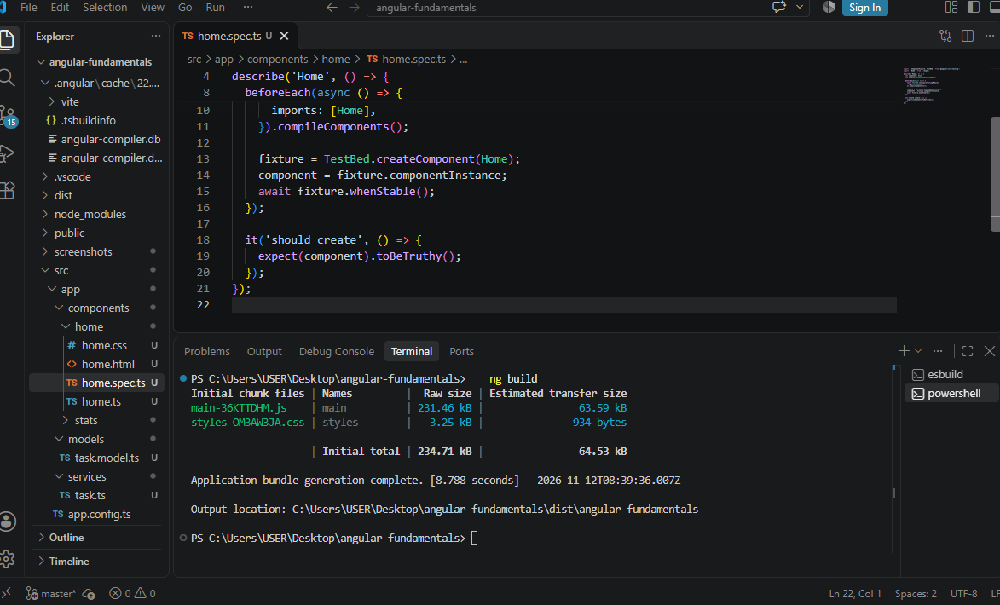
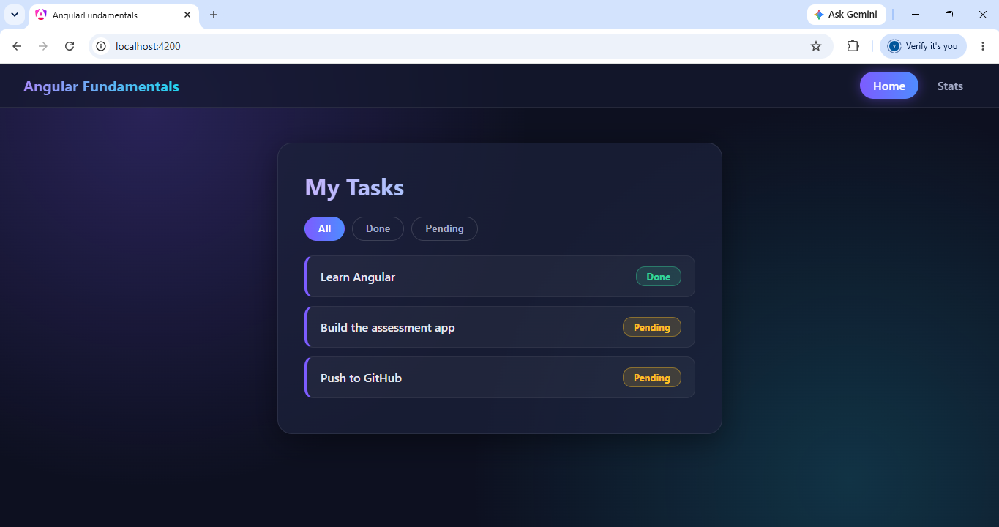
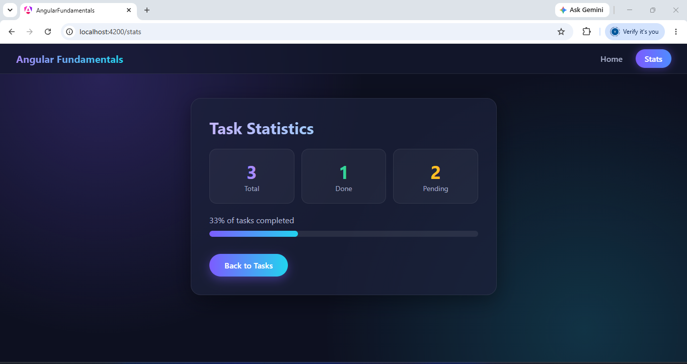

# Angular Fundamentals

## Overview
A small Angular app built with standalone components. It has an injectable service used through dependency injection, two routes with navigation links, and modern control flow (@if, @for, @switch).

- **Home (/)**: a task list with All / Done / Pending filter buttons.
- **Stats (/stats)**: a dashboard with total, done and pending counts and a progress bar.

## Setup and Run
    npm install -g @angular/cli
    npm install
    ng serve
Then open http://localhost:4200

## Build
    ng build

## Architecture
- `src/app/components/`: Home and Stats standalone components
- `src/app/services/task.ts`: TaskService, an @Injectable service used with inject()
- `src/app/models/task.model.ts`: Task interface
- `src/app/app.routes.ts`: routes for / (Home) and /stats (Stats)
- `src/app/app.html`: navigation bar using routerLink
- Control flow: Home uses @if, @for and @switch; Stats uses @for and @if

## Screenshots

### 1. Successful build

### 2. Control flow working

### 3. Second route after navigation

